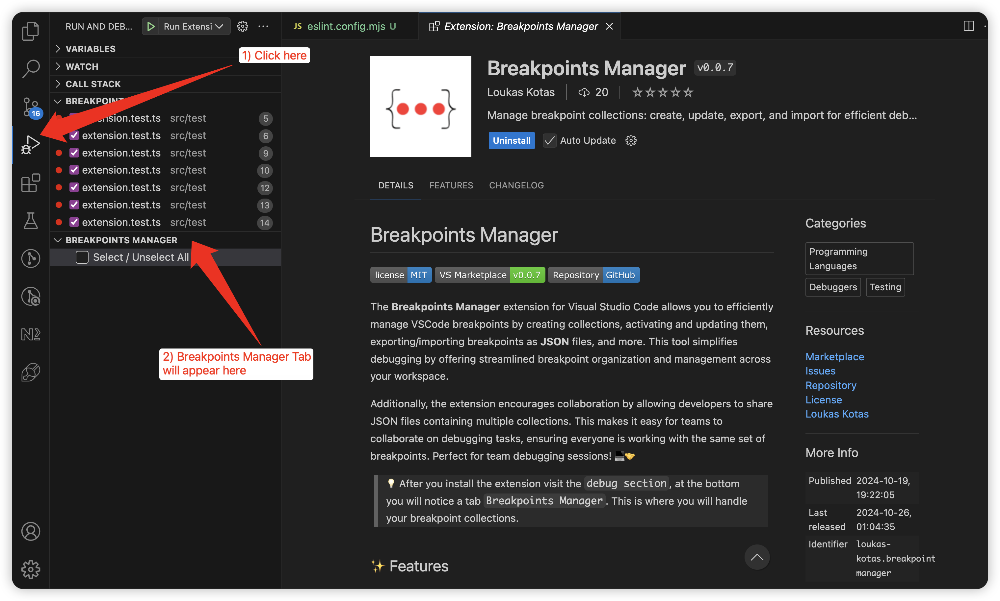
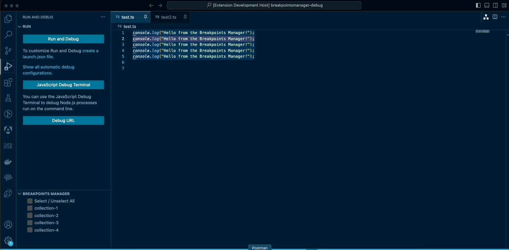

# Breakpoints Manager

[](./LICENSE)
[](https://marketplace.visualstudio.com/items?itemName=loukas-kotas.breakpoints-manager)
[](https://github.com/loukas-kotas/breakpoints-manager)

<!-- Add later -->
<!-- [](https://github.com/loukas-kotas/breakpoints-manager/blob/main/CONTRIBUTING.md) -->
<!-- [](https://marketplace.visualstudio.com/items?itemName=loukas-kotas.breakpoints-manager) -->

The **Breakpoints Manager** extension for Visual Studio Code allows you to efficiently manage VSCode breakpoints by creating collections, activating and updating them, exporting/importing breakpoints as **JSON** files, and more. This tool simplifies debugging by offering streamlined breakpoint organization and management across your workspace.

Additionally, the extension encourages collaboration by allowing developers to share JSON files containing multiple collections. This makes it easy for teams to collaborate on debugging tasks, ensuring everyone is working with the same set of breakpoints. Perfect for team debugging sessions! 💻🤝

> 🤖 **Now Agentic!** Breakpoints Manager ships with an **MCP (Model Context Protocol) server** so AI coding assistants (Claude Desktop, Kilo Code, and any MCP-compatible client) can *see*, *create*, and *manage* your breakpoints directly. Your assistant can drop breakpoints on the right lines, activate the right collection, and reason about your debugging state — all without you touching the UI.

>💡 After you install the extension visit the `debug section`, at the bottom you will notice a tab `Breakpoints Manager`. This is where you will handle your breakpoint collections.

<br>

## 🤖 Agentic Debugging with MCP

Breakpoints Manager exposes a **Model Context Protocol (MCP)** server that lets AI assistants manage your breakpoints inside the current VS Code workspace. Once connected, the assistant can:

&nbsp;&nbsp;&nbsp;📍 **Add / remove breakpoints** on specific files and lines (with optional conditions, hit counts, or logpoints).
&nbsp;&nbsp;&nbsp;📋 **List active breakpoints** and inspect the current debugging state.
&nbsp;&nbsp;&nbsp;🗂️ **Create, list, activate, and delete collections** — drive the whole Breakpoints Manager workflow from a prompt.

The MCP server runs as a standalone process (`@breakpoints-manager/mcp-server`) and communicates with the **running extension** through a tiny local bridge. You do **not** need to configure ports, tokens, or URLs — the extension writes a connection file to `~/.breakpoints-manager/.mcp.json` and the server reads it automatically. Just make sure VS Code (with the extension active) is open with a workspace folder loaded.

### Tools exposed to the agent

| Tool | What it does |
| --- | --- |
| `add_breakpoint` | Add a breakpoint (optionally to a collection) with condition / hit condition / log message. |
| `remove_breakpoint` | Remove a breakpoint from the workspace (and optionally from a collection). |
| `list_breakpoints` | List the currently active breakpoints in VS Code. |
| `create_collection` | Create a new collection from the current breakpoints. |
| `set_active_collection` | Load a stored collection as the active breakpoints. |
| `list_collections` | List the stored collections. |
| `remove_collection` | Delete a stored collection. |

---

### Add the MCP server to your client

The server is distributed as the npm package **`@breakpoints-manager/mcp-server`**, exposing the binary **`breakpoints-manager-mcp`**. Use `npx -y` (or install it globally) so the client can launch it on demand.

#### Claude Desktop

Edit `claude_desktop_config.json` (Settings → Developer → Edit Config) and add a `mcpServers` entry:

```json
{
  "mcpServers": {
    "breakpoints-manager": {
      "command": "npx",
      "args": ["-y", "@breakpoints-manager/mcp-server"]
    }
  }
}
```

Restart Claude Desktop. The **Breakpoints Manager** tools should appear under the tools list once VS Code (with the extension active) is open.

#### Kilo Code / VS Code (`.vscode/mcp.json`)

Create or update `.vscode/mcp.json` in your workspace:

```json
{
  "mcpServers": {
    "breakpoints-manager": {
      "command": "npx",
      "args": ["-y", "@breakpoints-manager/mcp-server"]
    }
  }
}
```

Kilo Code (and the VS Code MCP host) will pick up the server automatically. Make sure the Breakpoints Manager extension is activated in the same VS Code window.

#### Other MCP-compatible clients

Any client that supports **stdio** MCP servers can connect with the same command:

```json
{
  "mcpServers": {
    "breakpoints-manager": {
      "command": "npx",
      "args": ["-y", "@breakpoints-manager/mcp-server"]
    }
  }
}
```

> 💡 If `npx` isn't on your client's `PATH`, replace `npx` with the absolute path to your Node binary and keep the `args` as shown.

<br>
  

<br>

## ✨ Features

&nbsp;&nbsp;&nbsp;🔖 **Create Collections**: Organize breakpoints into collections for easier management.

&nbsp;&nbsp;&nbsp;⚡ **Activate Collection**: Quickly activate a collection of breakpoints.

&nbsp;&nbsp;&nbsp;🔄 **Update Collection**: Modify breakpoints within a collection and update them without needing to recreate.

&nbsp;&nbsp;&nbsp;📤 **Export Collections**: Save your collections as JSON files to reuse or share.

&nbsp;&nbsp;&nbsp;📥 **Import Collections**: Import previously saved collections for quick access.

&nbsp;&nbsp;&nbsp;✅ **Select All Collections**: Easily select and manage multiple collections at once.

&nbsp;&nbsp;&nbsp;🔍 **Search Collections**: Quickly find a specific collection by name.

&nbsp;&nbsp;&nbsp;🗑️ **Delete Collections**: Remove unwanted collections from the manager.

&nbsp;&nbsp;&nbsp;🤖 **Agentic / MCP**: Connect Claude Desktop, Kilo Code, or any MCP client to let AI assistants manage your breakpoints.

<br>

## 🛠️ Requirements

No special requirements or dependencies. Just install and start managing your breakpoints!

<br>

## 📸 Feature Demos

Here are demonstrations of how each feature works:

### **Create Collections**  
  

### **Activate Collection**  
  

### **Update Collection**  
  

### **Export Collections**  
  

### **Import Collections**  
  

### **Search Collection**  
  

### **Delete Collections**
  

<br>

## ⚠️ Known Issues

- Importing too many collections at once may slow down the UI.
- Breakpoints outside the current workspace may not be fully supported.

<br>

## Changelog

Stay updated with the latest changes and improvements! You can find a detailed list of all updates in the [CHANGELOG](https://github.com/loukas-kotas/breakpoints-manager/blob/main/CHANGELOG.md).

<br>


## Bug Reports & Feature Requests

If you encounter any issues or have ideas for new features, feel free to contribute by opening a:

- 🐛 [Bug Report](https://github.com/loukas-kotas/breakpoints-manager/issues/new?assignees=&labels=bug&template=bug_report.md&title=)
- ✨ [Feature Request](https://github.com/loukas-kotas/breakpoints-manager/issues/new?assignees=&labels=enhancement&template=feature_request.md&title=)

<br>

### **Enjoy Debugging!**
